<h1 align="center">Paulo Cardoso</h1>

  

## English

I'm a full-stack developer based in Recife, Brazil. I build web applications, APIs, and developer tools — from requirements to deployment.

### About me

I work as a Full Stack Developer at the City of Jaboatão dos Guararapes, building and running the city's internal web systems with **React**, **Next.js**, **TypeScript**, **Fastify**, and **Prisma**. On my own projects I also work with **Java** and **Spring Boot**, and I care a lot about security and self-hosted infrastructure.

- Migrated the city's timesheet system from a legacy ScriptCase app to Node.js and React, now serving about 12,000 public employees.
- Shipped and maintain a parking permit platform that issues around 10 permits per day.

### Tech stack

- **Languages:** TypeScript, JavaScript, Java
- **Frontend:** Next.js, React, Angular, Tailwind CSS
- **Backend:** Node.js, Fastify, Spring Boot, Prisma
- **Data:** PostgreSQL, MySQL, Redis
- **Tools:** Git, Docker, Playwright

### Projects

- **[Cynops Tools](https://github.com/paulosnp/cynops-tools)** — Self-hosted, invite-only hub with 16 document, image, and data tools. Async jobs with BullMQ, BFF authentication with MFA, and Docker on my own ARM VM behind a Cloudflare Tunnel.
- **[Cata Log](https://github.com/paulosnp/cata-log-platform)** — Marketplace for artisans, built as my college final project. Spring Boot REST API with JWT and multi-tenant isolation, React storefront and admin panel, and a Flutter app.
- **[Caveman Commit](https://github.com/paulosnp/auto-commit-plugin)** — A VS Code extension that generates commit messages with Codex CLI or Claude Code CLI.

## Português

Sou desenvolvedor full stack em Recife. Crio aplicações web, APIs e ferramentas para desenvolvedores, do levantamento de requisitos ao deploy.

### Sobre mim

Trabalho como Desenvolvedor Full Stack na Prefeitura do Jaboatão dos Guararapes, desenvolvendo e mantendo sistemas web internos com **React**, **Next.js**, **TypeScript**, **Fastify** e **Prisma**. Nos projetos pessoais também uso **Java** e **Spring Boot**, com atenção especial a segurança e infraestrutura própria.

- Migrei o sistema de folha de ponto do legado em ScriptCase para Node.js e React; hoje ele atende cerca de 12 mil servidores.
- Publiquei e mantenho uma plataforma de credenciais de estacionamento que emite em média 10 credenciais por dia.

### Tecnologias

- **Linguagens:** TypeScript, JavaScript, Java
- **Frontend:** Next.js, React, Angular, Tailwind CSS
- **Backend:** Node.js, Fastify, Spring Boot, Prisma
- **Dados:** PostgreSQL, MySQL, Redis
- **Ferramentas:** Git, Docker, Playwright

### Projetos

- **[Cynops Tools](https://github.com/paulosnp/cynops-tools)** — Hub self-hosted, com acesso por convite, com 16 ferramentas de documentos, imagens e dados. Jobs assíncronos com BullMQ, autenticação via BFF com MFA e Docker numa VM ARM própria, atrás de um Cloudflare Tunnel.
- **[Cata Log](https://github.com/paulosnp/cata-log-platform)** — Marketplace para artesãos, meu projeto final da faculdade. API REST em Spring Boot com JWT e isolamento multi-tenant, vitrine e painel em React e app em Flutter.
- **[Caveman Commit](https://github.com/paulosnp/auto-commit-plugin)** — Extensão para VS Code que gera mensagens de commit com Codex CLI ou Claude Code CLI.

## Connect / Contato

[LinkedIn](https://linkedin.com/in/paulosnp) · [Portfolio / Portfólio](https://me.prismcode.site) · [Email / E-mail](mailto:paulocardoso64h@gmail.com)

## Contributions / Contribuições

<!-- Snake animation kept hidden for later use.

  <picture>
    <source media="(prefers-color-scheme: dark)" srcset="https://raw.githubusercontent.com/paulosnp/paulosnp/output/github-contribution-grid-snake-dark.svg" />
    <source media="(prefers-color-scheme: light)" srcset="https://raw.githubusercontent.com/paulosnp/paulosnp/output/github-contribution-grid-snake.svg" />
    
  </picture>

-->

  <picture>
    <source media="(prefers-color-scheme: dark)" srcset="assets/bomberman-contribution-graph-dark.svg" />
    <source media="(prefers-color-scheme: light)" srcset="assets/bomberman-contribution-graph.svg" />
    
  </picture>

